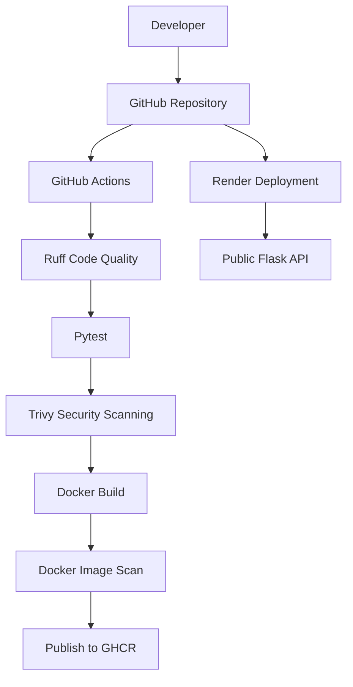

# Secure DevOps Pipeline


A beginner-friendly **DevSecOps project** demonstrating how to build, test, secure, containerize, and deploy a Python REST API using modern DevOps tools.

The project implements an automated CI/CD pipeline with code quality checks, automated tests, security scanning, Docker image publishing, and cloud deployment.

## Live Demo

**API URL:** https://secure-devops-api.onrender.com

Available endpoints:

- `GET /` — API information
- `GET /health` — Health check
- `GET /tasks` — Retrieve all tasks
- `POST /tasks` — Create a task

> Note: The API uses in-memory storage. Tasks are not persistent and may be lost when the service restarts. The Render free instance may also spin down after inactivity.

## Project Overview

The objective of this project is to understand and implement a basic DevSecOps workflow, from application development to automated deployment.

### Main Features

- REST API developed with Python and Flask.
- Automated unit and integration tests using Pytest.
- Python code quality checks using Ruff.
- Application containerization using Docker.
- Non-root user configuration inside the Docker container.
- Automated CI/CD pipeline using GitHub Actions.
- Source code and Docker image security scanning with Trivy.
- Docker image publishing to GitHub Container Registry (GHCR).
- Dependency update automation using Dependabot.
- Cloud deployment using Render.

## Architecture



## Technologies

| Category | Technologies |
|---|---|
| Programming language | Python 3.12 |
| API framework | Flask |
| Testing | Pytest |
| Code quality | Ruff |
| Containerization | Docker |
| CI/CD | GitHub Actions |
| Security scanning | Trivy |
| Container registry | GitHub Container Registry |
| Deployment | Render |
| Dependency automation | Dependabot |
| Version control | Git, GitHub |

## Project Structure

```text
secure-devops-pipeline/
│
├── .github/
│   ├── workflows/
│   │   └── ci.yml
│   └── dependabot.yml
│
├── app.py
├── test_app.py
├── requirements.txt
├── requirements-dev.txt
├── Dockerfile
└── README.md
```

## Getting Started

### Prerequisites

- Python 3.12 or newer
- Git
- Docker (optional, for container execution)

### 1. Clone the repository

```bash
git clone https://github.com/abdo-barroug/secure-devops-pipeline.git

cd secure-devops-pipeline
```

### 2. Create a virtual environment

**Windows PowerShell:**

```powershell
py -m venv .venv

.\.venv\Scripts\Activate.ps1
```

### 3. Install dependencies

```bash
python -m pip install -r requirements-dev.txt
```

### 4. Run the application

```bash
python app.py
```

The API will be available at:

http://localhost:8000

## API Usage

### Health Check

```http
GET /health
```

Example response:

```json
{
  "status": "healthy"
}
```

### Retrieve Tasks

```http
GET /tasks
```

### Create a Task

```http
POST /tasks
Content-Type: application/json
```

Example request:

```json
{
  "title": "My first DevOps task"
}
```

Example response:

```json
{
  "id": 1,
  "title": "My first DevOps task",
  "completed": false
}
```

The API validates incoming requests and returns HTTP 400 for invalid input.

## Running Tests

Run the automated test suite:

```bash
python -m pytest -v
```

The test suite currently contains 10 tests covering:

- API home endpoint.
- Health check endpoint.
- Initial task retrieval.
- Task creation.
- Empty title validation.
- Invalid JSON validation.
- Missing title validation.
- Whitespace-only title validation.
- Non-string title validation.
- Title whitespace trimming.

## Code Quality

Run Ruff to check Python code quality:

```bash
ruff check .
```

Ruff is also integrated into the GitHub Actions workflow.

## Docker

### Build the Docker image

```bash
docker build -t secure-devops-api .
```

### Run the container

```bash
docker run -d -p 8000:8000 --name secure-devops-api secure-devops-api
```

### Test the container

```bash
curl http://localhost:8000/health
```

### Stop the container

```bash
docker stop secure-devops-api
docker rm secure-devops-api
```

The Docker image uses a lightweight Python base image and runs the application as a non-root user.

## CI/CD Pipeline

GitHub Actions automatically executes the pipeline on pushes to `main` and pull requests targeting `main`.

The workflow includes the following stages:

### 1. Code Quality

- Install Python dependencies.
- Run Ruff to detect code quality issues.

### 2. Automated Testing

- Execute the Pytest test suite.
- Stop the pipeline if tests fail.

### 3. Security Scanning

Trivy performs two types of scans:

- Filesystem scan: checks dependencies, secrets, and configuration issues.
- Docker image scan: checks container image vulnerabilities.

The pipeline is configured to fail when matching HIGH or CRITICAL findings are detected. The image scan ignores vulnerabilities without available fixes.

### 4. Docker Build

Build the application Docker image.

### 5. Image Publishing

After successful validation, publish the Docker image to GitHub Container Registry.

Pull the published image:

```bash
docker pull ghcr.io/abdo-barroug/secure-devops-api:latest
```

Run it:

```bash
docker run -d -p 8000:8000 ghcr.io/abdo-barroug/secure-devops-api:latest
```

The publishing job runs on pushes and manual workflow executions, but not on pull requests.

## Dependency Management

Dependabot is configured to check for updates weekly for:

- Python dependencies.
- GitHub Actions dependencies.

## Deployment

The application is deployed on Render using the repository's Dockerfile.

**Live URL:** https://secure-devops-api.onrender.com

The application reads its port from the `PORT` environment variable, allowing it to run in different environments.

## Limitations and Future Improvements

This project is a learning-oriented implementation. Possible improvements include:

- Replace in-memory storage with PostgreSQL.
- Add authentication and authorization.
- Implement task update and deletion endpoints.
- Add API documentation using Swagger/OpenAPI.
- Improve deployment security and monitoring.
- Add more comprehensive integration tests.

## Author

**Abdellah Barroug**

Computer Engineering Student — Grenoble INP – Polytech Grenoble

Interested in Cybersecurity, DevOps, and Network Engineering.

- GitHub: [abdo-barroug](https://github.com/abdo-barroug)
- LinkedIn: [Abdellah Barroug](https://www.linkedin.com/in/abdellah-barroug-782973248/)

---

*This project was developed as a practical introduction to DevOps and DevSecOps practices.*